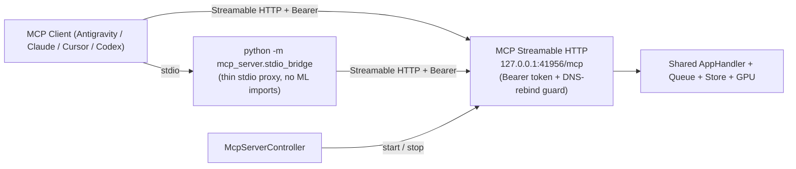

# MCP Server (Model Context Protocol)

LTX Desktop includes an opt-in, loopback-only **Model Context Protocol (MCP)** server so AI agents and coding assistants (Antigravity, Claude Code, Claude Desktop, Cursor, Codex, and custom MCP clients) can inspect hardware capabilities, browse assets, enhance prompts, queue video/image/LoRA generations with live progress streaming, and manage the shared generation queue.

MCP clients share the single running `AppHandler`, SQLite store, asset library, and GPU queue with Desktop and Remote — every job queued via MCP appears live in the LTX Desktop queue UI.

## Architecture



## Quickstart

1. Open **Settings > General > MCP Server** and turn on **Enable MCP Server**.
2. Optionally turn on **Allow local media import** if you want MCP clients to import image, video, or audio files from disk into your asset library (`import_asset`).
3. Connect your MCP client using either **Stdio Bridge** (recommended — automatically reads the local token file and survives token rotation/app rebuilds) or **Streamable HTTP**.

### Option A: Stdio Bridge (Recommended)

The stdio bridge starts instantaneously (no PyTorch/model imports) and proxies requests to the running LTX Desktop app on `127.0.0.1:41956/mcp`, reading `{app_data_dir}/mcp-token.json` automatically.

**macOS (`/Applications/LTX Desktop.app`):**

```json
{
  "mcpServers": {
    "ltx-desktop": {
      "command": "/Applications/LTX Desktop.app/Contents/Resources/python/bin/python3",
      "args": ["-m", "mcp_server.stdio_bridge"],
      "env": {
        "PYTHONPATH": "/Applications/LTX Desktop.app/Contents/Resources/backend"
      }
    }
  }
}
```

**Claude Code CLI:**

```bash
claude mcp add -s user ltx-desktop \
  --env PYTHONPATH="/Applications/LTX Desktop.app/Contents/Resources/backend" \
  -- "/Applications/LTX Desktop.app/Contents/Resources/python/bin/python3" \
  -m mcp_server.stdio_bridge
```

**Codex CLI:**

```bash
codex mcp add ltx-desktop \
  --env PYTHONPATH="/Applications/LTX Desktop.app/Contents/Resources/backend" \
  -- "/Applications/LTX Desktop.app/Contents/Resources/python/bin/python3" \
  -m mcp_server.stdio_bridge
```

### Option B: Direct Streamable HTTP

Copy the URL and Bearer token from **Settings > General > MCP Server** (or `GET /api/mcp/client-config`):

```json
{
  "mcpServers": {
    "ltx-desktop": {
      "url": "http://127.0.0.1:41956/mcp",
      "headers": {
        "Authorization": "Bearer <your-mcp-token>"
      }
    }
  }
}
```

## Capabilities

### Tools (27)

- **Discovery & Prompts:** `get_system_status`, `list_models`, `list_recipes`, `get_recipe_guidance`, `enhance_prompt`
- **Assets & Media:** `list_assets`, `get_asset`, `view_asset` (returns bounded JPEG `ImageContent`), `import_asset` (opt-in), `extract_frame`, `trim_media`, `extract_audio`, `delete_asset`
- **Generation (all accept optional `idempotency_key`):** `generate_video`, `image_to_video`, `audio_to_video`, `generate_image`, `run_lora_recipe`, `run_video_recipe`, `run_ingredients`, `extend_video`, `retake_video`
- **Queue & Lifecycle:** `get_queue`, `list_generations`, `get_generation`, `wait_for_generation` (streams MCP `notifications/progress` updates), `manage_generation` (`cancel` / `retry` / `reorder`)

### Resources (`ltx://`)

- `ltx://status` (`application/json`)
- `ltx://models` (`application/json`)
- `ltx://recipes` (`application/json`)
- `ltx://recipes/{recipe_id}/guidance` (`text/markdown`)
- `ltx://queue` (`application/json`)
- `ltx://generations/{generation_id}` (`application/json`)
- `ltx://assets/{asset_id}` (`application/json`)
- `ltx://assets/{asset_id}/preview` (`image/jpeg`)

### Prompts (4)

- `storyboard_to_video` — Multi-shot continuity workflow using `extract_frame` + `image_to_video`
- `restyle_video` — Safe IC-LoRA video-to-video restyling workflow
- `consistent_character_video` — Character/prop reference sheet workflow using `run_ingredients`
- `refine_and_extend_clip` — Guided `retake_video` / `extend_video` post-production workflow

## Security Model

- **Disabled by default (fail-closed):** `mcp_enabled` defaults to `false`; no socket binds until explicitly turned on.
- **Loopback-only (`127.0.0.1`):** Never bound to LAN interfaces (`0.0.0.0`).
- **Owner-only Bearer token:** 256-bit random token stored in `{app_data_dir}/mcp-token.json` with `0600` permissions on POSIX, verified in constant time (`hmac.compare_digest`), and rotatable from Desktop Settings (`POST /api/mcp/token/rotate`).
- **DNS rebinding & CSRF protection:** Enforces `TransportSecuritySettings` (`allowed_hosts` restricted to loopback) + `TrustedHostMiddleware` and rejects any request carrying a browser `Origin` header (`403 Forbidden`).
- **Opt-in local file import:** `import_asset` is blocked (`LOCAL_IMPORT_DISABLED`) unless **Allow local media import** is enabled, and only accepts valid image/video/audio media probed by `AssetHandler.ingest_asset`.
- **No secret or control-plane leakage:** `ltx_api_key`, `fal_api_key`, `gemini_api_key`, and Hugging Face OAuth tokens are never returned by MCP tools/resources, and `/api/mcp/*` control routes are never mounted on the Remote LAN port (`:41955`).
